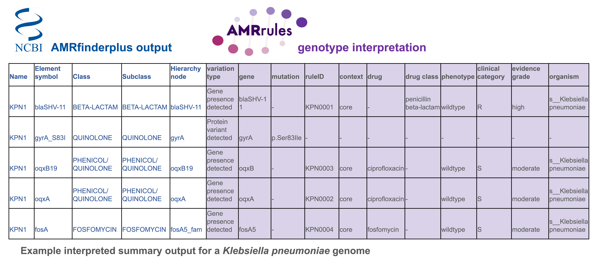
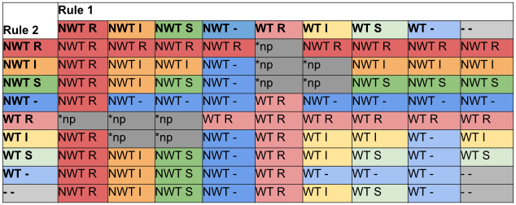
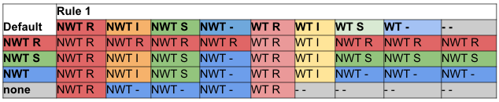

*******************************
Interpretation logic and output
*******************************

Interpreted AMRFinderPlus output
================================

When given an AMRFinderPlus input file, and an organism, AMRrules will apply the most relevant organism-specific rule to each AMRFinderPlus AMR genotype call. Below is an abbreviated example of the interpreted output file generated by AMRrules. (More examples can be found in :ref:`Tests <test>`).

The resulting output file is stored as ``<output_prefix>_interpreted.tsv``.

When parsing the AMRFinderPlus input file, AMRrules will first identify what ``variation type`` each genotype call belongs to, the ``gene`` found, and if there is a mutation in the gene, this mutation will be converted to the :ref:`AMRrules syntax <syntax>`. The interpreted output is sorted by marker so users can easily identify multi-copy or combination rule rows that have been added, or when rows have been duplicated due to multiple different drugs applying to the same marker.

The table below shows the logic of how AMRrules maps AMRFinderPlus genotype calls to the different variation types:

================================ ================================ =====================================================
Variation type                   AMRFP Method                     Additional logic
================================ ================================ =====================================================
Gene presence detected           EXACT, ALLELE, BLAST
Protein variant detected         POINTX, POINTP
Nucleotide variant detected      POINTN
Promoter variant detected        POINTN                           ``-`` symbol present before the nucleotide position
Inactivating mutation detected   INTERNAL_STOP, PARTIAL, POINTX   If POINTX, Subtype must be POINT_DISRUPT
================================ ================================ =====================================================
                           

The parsed ``variation type``, ``gene``, and ``mutation`` columns are added to the interpreted output file, next to the original AMRFinderPlus columns.

.. note::

   If ``--print-non-amr`` is provided to AMRrules, then any additional hits from AMRFinderPlus that are not AMR-related (eg virulence, stress, or metal resistance genes) will also be included in the interpreted output file. These entries will have ``variation type`` set to ``Non-AMR element``, and ``gene`` and ``mutation`` set to ``-``. No rules will be applied to these entries, and all annotation columns will be set to ``-``.

Drug mapping
------------

AMRrules maps the AMRFinderPlus calls to ``drug`` or ``drug class`` names from the CARD ARO, by parsing the ``Subclass`` columns. The dictionary used to map AMRFinderPlus ``Subclass`` to CARD ontology is in the AMRrules repository under ``src/amrrules/resources/amrfp_to_card_drugs_classes.txt``.

Some genotype calls have multiple entries in the AMRFinderPlus ``Subclass`` field. In such cases, the annotated calls output by AMRrules will contain multiple copies of the genotype row, one for each mapped drug/class. E.g. `aac6-Ib-cr <https://www.ncbi.nlm.nih.gov/pathogens/refgene/#aac6-Ib-cr>`__ is assigned to Subclass "AMIKACIN/KANAMYCIN/QUINOLONE/TOBRAMYCIN" in RefGene/AMRFinderPlus, so the AMRrules-annotated genotype file will contain 4 rows for this gene, one each for ``drug`` = ``amikacin``, ``drug`` = ``tobramycin``, ``drug`` = ``kanamycin``, and ``drug class`` = ``fluoroquinolone antibiotic``

Rule matching
-------------

When matching a genotype call with a rule, the following logic applies:

1. AMRrules will select all rules matching the ``variation type``.
2. AMRrules will filter all possible rules to check if the ``nodeID`` from the rule matches to ``Hierarchy node``. If not, it will check the parent nodes of ``Hierarchy node`` to look for a matching ``nodeID``.
3. If no matching ``nodeID`` is found, AMRrules will then check for matching accessions in the following order:

   a. ``nucleotide accession``
   b. ``protein accession``
   c. ``HMM accession``

For each matching rule, AMRrules appends the following fields from the rules file to the AMRFinderPlus genotype call:

* ruleID
* gene context
* drug
* drug class
* phenotype
* clinical category
* evidence grade
* version
* organism

To get more detailed annotation, set ``--annot-opts full``, which will add the following additional fields from the rule file:

* breakpoint
* breakpoint standard
* breakpoint condition
* evidence code
* evidence limitations
* PMID
* rule curation note

.. note::

   If multiple rules match to a genotype call, then the genotype call is duplicated, and the relevant information from additional rules is appended. For example, if the genotype call for ``aac(3)`` matches to two different rules, one for amikacin and one for kanamycin, then the ``aac(3)`` row will be represented twice in the output file, and the rule information for the amikacin will be appended on one row, and kanamycin on the second row.

Copy number rule matching
^^^^^^^^^^^^^^^^^^^^^^^^^

Copy number rules handle genetic variations where resistance depends on gene duplication or the copy frequency of a mutation across multi-copy genes (such as ribosomal RNA genes). 

Matching for copy number rules follows a four-step process:

1. Each individual marker detected in the genome is initially matched to its single-copy rule equivalent. 
2. AMRrules counts the overall number of matching gene hits or variant occurrences across the genome for that marker.
3. The engine then evaluates the total count against the organism's rule set to identify if a specific copy number rule applies (e.g., ``c.[2059A>G][4]`` for 4 mutant copies, or ``c.[2]`` for a gene duplication).
4. If a copy number rule is satisfied, AMRrules adds a dedicated row for that copy number rule to the interpreted output report. In this row, all original AMRFinderPlus columns are set to ``-``, while the rule annotation fields display the copy-number specific interpretation.

.. important::

   AMRFinderPlus is only able to detect copy number variants in completed genome assemblies. Therefore, if copy number rules exist for a detected marker and organism, by default the engine will flag in the evidence grade column a warning to the user in the genome summary report that this marker may be a copy number variant (``low (copy number variant)``). However, if you have used a completed genome assembly, or wish to override this warning, you can use the ``--trust-multi-copy`` option to force the engine to apply copy number rules correctly. 

Combination Rules
^^^^^^^^^^^^^^^^^

Combination rules are used to combine the effects of multiple individual rules. Matching combination rules follows this process: 
1. For each drug or drug class, the engine extracts all individual rules that have been applied. 
2. The engine searches the combination rules for this organism and evaluates the logic strings (e.g. "rule1 & rule2 | rule3") to determine if any apply. 
3. If a combination rule applies, a new row is added to the interpreted output report. This row sets the original AMRFinderPlus columns to ``-``, while the rule annotation fields display the combination-specific interpretation. The ``gene`` column will display the rule logic using the markers that have been detected in the genome. For example, if a combination rule is defined as (markerA & markerB) & (markerC \| marker D), and the genome has markerA, B and D, then the ``gene`` column will display ``markerA & markerB & markerD``. 

:ref:`See details <combo_rules_spec>` about the rules specification for more information on combination rules and how they are used.

Genome summary report
=====================

In addition to the interpreted AMRFinderPlus output file, AMRrules will also generate a genome summary report, stored as ``<output_prefix>_summary.tsv``. This file summarises the resistance per drug/drug class, based on the matched rules.

Some example output files are shown on the :ref:`installation <check-the-installation>` page.

The following columns are included:

=================== ====================================================================================================
  Column              Explanation                                                                                                              
=================== ====================================================================================================
  sample              Sample ID                                                                                                                
  drug                Drug, as per CARD ARO. AMRFinderPlus drugs will be converted to CARD ARO format by AMRrules                              
  drug class          Drug class, as per CARD ARO. AMRFinderPlus drugs will be converted to CARD ARO format by AMRrules                       
  clinical category   S/I/R. Highest level of resistance based on markers that match this drug/drug class                                  
  phenotype           Wildtype or nonwildtype. Highest level based on markers that match this drug/drug class                                  
  evidence grade      None/very low/low/moderate/high. Highest grade of evidence for markers that match to the highest interpretation level (nwt > wt, R > I > S) for this drug/drug class. None is used when we have no evidence for the call, as is the case of rule-less markers.                       
  markers (non-S)     Markers with rules specifying clinical category I or R, separated by ``;``
  markers (no rule)   Markers with no rule, separated by ``;``                                                                 
  markers (S)         Markers with rules specifying clinical category S, separated by ``;``                      
  supporting rules    List of IDs for rules that support the interpretation for this drug/drug class, separated by ``;``                                                     
  other rules         List of all other rules encountered for this drug/drug class, separated by ``;``. Off by default, but can be switched on with ``--list-all-rules``.
  organism            Organism whose rules were applied  
  version             AMRrules version                                                                                      
=================== ====================================================================================================

**Marker labels** 

• Marker labels are formatted as ``gene:mutation``, where the mutation is formatted using :ref:`AMRrules syntax <syntax>`
• If the variation type is ``Gene inactivating mutation`` the marker will be labelled as ``gene:-`` (where the ``-`` implies inactivation or functional loss).
• If the variation type is ``Gene presence detected``, the marker label will be simply ``gene``. 
• If ``flag-core`` has been switched on, markers with rules that have ``gene context == 'core'`` will be flagged with ``(core)`` after the marker. This is the case only if the ``variation type`` for that marker is ``Gene presence detected``. eg the core blaSHV gene in *K. pneumoniae* will now be in the ``markers (non-S)`` column as ``blaSHV-11 (core)`` for penicillin beta-lactam.

.. note::

   AMRFinderPlus genotype calls detected using POINT_DISRUPT contain detailed information about the disruption, which is formatted using HGVS syntax. For simplicity, by default the AMRrules genome summary report **will not show** the full mutation after the gene when listing these markers in the genome summary (although they can always be found in the annotated genotype report). Rather, they will be formatted in the genome summary report as ``gene:-`` as per other inactivating mutations. If you wish to show the full mutation detected by AMRFinderPlus in the summary report, this can be turned on by providing the option ``--full-disrupt`` to the AMRrules call.

Determining final interpretation for a drug/drug class
------------------------------------------------------

The final interepretation for a drug or drug class is determined by comparing the clincial category and phenotype of all matching rules, and determining the highest level. Rules are assessed in a pairwise fashion, where the winning interpretation is determined as per the below table:

**Combining Two Rules**

*(Note: `*np` denotes “not possible” rule combinations that are logically incompatible within a rule set for a given drug)*

If rule-less markers are present for this particular drug/drug class, then the highest interpretation from the rules is then combined with the selected interpretation for rule-less markers (default ``none``, see :ref:`handling_ruleless_calls` for details). 

This table below demonstrates which interpretation "wins" when combining with rule-less markers:

**Combining a rule interpretation with rule-less markers**

.. _handling_ruleless_calls:

Handling rule-less genotype calls
^^^^^^^^^^^^^^^^^^^^^^^^^^^^^^^^^

By default, if no organism-specific rule is found for a genotype reported by AMRFinderPlus, AMRrules will apply an interpretation based on the setting of ``--no-rule-interpretation``. The options for this parameter are:

• ``none`` (default): any unmatched genotype calls will not be assigned to a phenotype or clinical category (entires will be ``-``). Evidence grade will be set to ``none``, as we are not interpreting a phenotype or clinical category.
• ``nwt``: any unmatched genotype calls will be assigned the phenotype ``nonwildtype``, but no clinical category will be assigned (``-``). Evidence grade will be set to ``none``, as we are not interpreting a clinical category.
• ``nwtS``: any unmatched genotype calls will be assigned the phenotype ``nonwildtype`` and clinical category will be set to ``S``. Evidence grade will be set to ``none``, as there is no evidence for the call.
• ``nwtR``: any unmatched genotype calls will be assigned the phenotype ``nonwildtype`` and clinical category will be set to ``R``. Evidence grade will be set to ``none``, as there is no evidence for the call.

When there are no supporting rules for a particular drug/drug class, the ``supporting rules`` column will state ``none``, and if a ``--no-rule-interpretation`` option other than ``none`` is used, the default interpretation will be listed here (e.g. ``none (default nwtR)``).

Evidence grades
^^^^^^^^^^^^^^^

Evidence grades are assigned based on rules matching the highest clinical category for a particular drug/drug class. For example, if the supporting rules for an ``S`` interpretation had ``high`` evidence, the inclusion of a rule-less marker with an ``R`` interepration would result in a final evidence grade of ``none``, as we have no evidence for the rule-less marker. 

For markers involved in copy number rules, the evidence grade is changed to ``low (copy number variant)`` if the rule being applied is for a single marker only, as explained above. This can be switched off by using the ``--trust-multi-copy`` flag when running the engine. See the examples ``tests/data/example_output/test_ngono_single23S_copy_genome_summary.tsv`` and ``tests/data/example_output/test_gono_four23S_genome_summary.tsv``.

Example summary outputs
^^^^^^^^^^^^^^^^^^^^^^^

To demonstrate the difference between these options, you can compare the output files for the same genome, a MDR *Klebsiella pneumoniae* strain, using different interpretations for markers with no rules.

Using ``none`` (see ``tests/data/example_output/test_kpneumo_MDR_none_genome_summary.tsv``):

Almost all markers have no rules, and so no clinical category, phenotype or evidence grade are set. In the case of the call for ``penicillin beta-lactam``, we have an existing ``wildtype R`` rule for ``blaSHV-1``. Even though ``blaTEM-1`` is present, which has no rule, we still expect a ``wildtype R`` interpretation. Evidence grades are generally set to ``none``, as we have no rules matching these clinical category interpretations.

.. csv-table::
   :file: ../../tests/data/example_output/test_kpneumo_MDR_none_genome_summary.tsv
   :delim: tab
   :header-rows: 1

Using ``nwt`` (see ``tests/data/example_output/test_kpneumo_MDR_nwt_genome_summary.tsv``):

Now, all drugs with markers that have no rules have ``nonwildtype`` as their phenotype. This *does not* include the call for ``penicillin beta-lactam``, as a ``wildtype R`` rule overrides the ``nonwildtype`` phenotype, as even due to the presence of ``blaTEM-1`` we still expect a ``wildtype`` phenotype. Evidence grades are set to ``none`` for rows with no clinical category, as we have no evidence for these clinical category interpretations.

.. csv-table::
   :file: ../../tests/data/example_output/test_kpneumo_MDR_nwt_genome_summary.tsv
   :delim: tab
   :header-rows: 1

Using ``nwtS`` (see ``tests/data/example_output/test_kpneumo_MDR_nwtS_genome_summary.tsv``):

Now, all drugs with markers that have no rules have ``S`` as their clinical category, and ``nonwildtype`` as their phenotype. This creates an evidence grade of ``moderate`` for the ``ciprofloxacin`` row, as the rules for the markers ``oqxA`` and ``oqxB`` have a ``moderate`` evidence grade, and the addition of the rule-less marker ``qnrB1`` does not change this.

.. csv-table::
   :file: ../../tests/data/example_output/test_kpneumo_MDR_nwtS_genome_summary.tsv
   :delim: tab
   :header-rows: 1

Using ``nwtR`` (see ``tests/data/example_output/test_kpneumo_MDR_nwtR_genome_summary.tsv``):

Finally, all drugs with markers that have no rules have ``R`` as their clinical category, and ``nonwildtype`` as their phenotype. Evidence grades are generally set to ``none`` as we have no evidence for these calls.

.. csv-table::
   :file: ../../tests/data/example_output/test_kpneumo_MDR_nwtR_genome_summary.tsv
   :delim: tab
   :header-rows: 1
